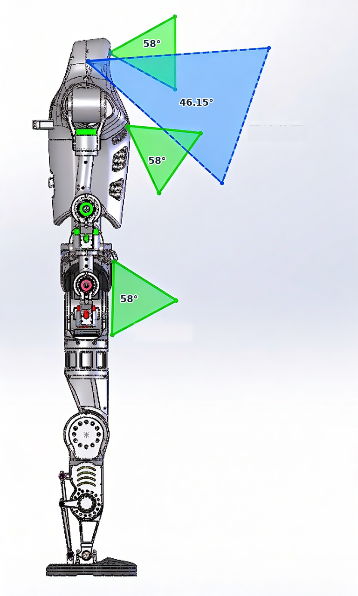
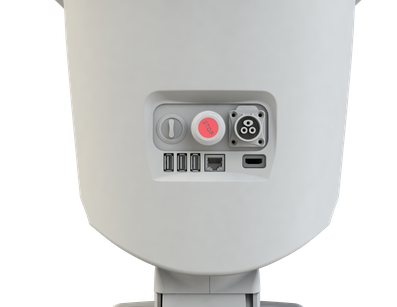

# Components and interfaces

This page describes the W1 sensing configuration and software interfaces.

## Sensing components

The environment and workpiece sensing configuration includes lidar, ToF cameras and a 3D line-scan camera.

| Component           | Reference quantity | Model and performance |
| ------------------- | ------------------ | --------------------- |
| Lidar               | 1                  | MID360                |
| ToF cameras         | 3                  | Realsense 435i        |
| 3D line-scan camera | 1                  |                       |

Sensor categories do not establish USB, Ethernet or other physical interfaces, power requirements or available SDKs. Quantities and models should be checked against the delivered configuration. For capability context, see [Capabilities and applications](./capabilities.md).

## Rear-panel interfaces

| Interface        | Quantity | Notes   |
| ---------------- | -------- | ------- |
| HDMI             | 1        | —       |
| USB              | 3        | 3.0     |
| Gigabit Ethernet | 1        | RJ45    |
| Charging port    | 1        | 5 A max |
| Emergency stop   | 1        |         |
| Power switch     | 1        |         |

## Software interfaces

The following software interfaces apply to the documented `speed_W1_v1.2` configuration. Software endpoints do not replace physical port numbers or wiring diagrams.

| Purpose                                  | Available endpoint                                     | Conditions and details                                                                                                                                                                                                                                    |
| ---------------------------------------- | ------------------------------------------------------ | --------------------------------------------------------------------------------------------------------------------------------------------------------------------------------------------------------------------------------------------------------- |
| Joint feedback                           | `/joint_states`                                        | Read by joint name; see the [ROS 2 example](../sdk/ros2-example.md#state-interfaces) for the message and read-only client                                                                                                                                 |
| IMU and hardware status                  | `/imu/data`, dynamic joint state and diagnostic topics | Provided by the relevant hardware broadcaster or monitoring node. The default mock does not provide hardware IMU data; see the [ROS 2 example](../sdk/ros2-example.md#state-interfaces)                                                                   |
| Weld-seam capture and program generation | `/weld_vision/capture_and_generate`                    | Also requires a camera, measured W1 hand–eye calibration, valid feedback and TeachPanel. The service is not associated with a specific camera in the table above; see [welding application services](../sdk/ros2-example.md#welding-application-services) |
| Whole-body and arm control               | PVT and grouped joint commands                         | See [W1 whole-body control](../api/w1-control.md) for joint order, units, sessions and configuration restrictions                                                                                                                                         |

The available software integration path is in the [W1 ROS 2 example](../sdk/ros2-example.md). Formal hardware connection steps will be added when the relevant material is ready.
