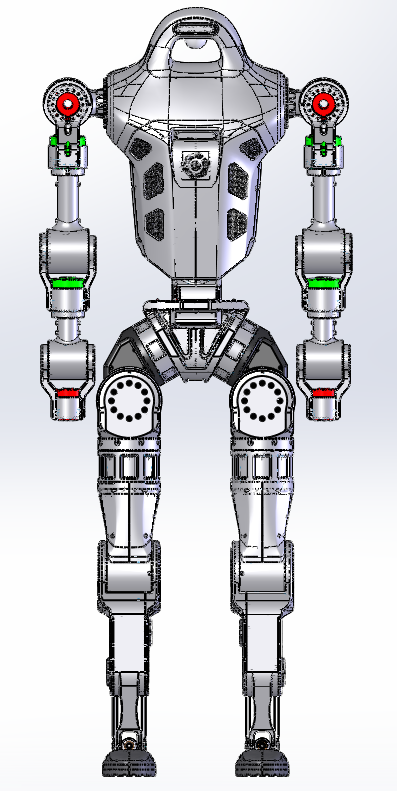

# Models and specifications

This page lists some of W1's main parameters.

## Identify a model

| Identifier                     | Available information                                      |
| ------------------------------ | ---------------------------------------------------------- |
| Product name                   | Weldroid-W1                                                |
| Physical identification        | See the cover image                                        |
| ROS 2 configuration identifier | This manual's interface documentation uses `speed_W1_v1.2` |

For software configuration and discovery commands, see [W1 whole-body control](../api/w1-control.md).

## Reference body parameters

Mechanical structure diagram

| Parameter                     | Reference value            | Unit | Conditions and notes                                           |
| ----------------------------- | -------------------------- | ---- | -------------------------------------------------------------- |
| Robot form                    | Full-size bipedal humanoid | —    | Intended for complex welding workstations such as shipbuilding |
| Height                        | Approximately 1.7          | m    |                                                                |
| Whole-body degrees of freedom | 28                         | —    | See the mechanical drawing                                     |
| Single-arm payload            | 10                         | kg   |                                                                |
| Whole-robot payload           | 30                         | kg   |                                                                |

## Metrics and conditions

| Metric                  | Measured data                 |
| ----------------------- | ----------------------------- |
| Maximum walking speed   | 1.5 m/s                       |
| Maximum obstacle height | 25 cm                         |
| Battery specification   | 48 V 20 Ah                    |
| Runtime                 | 4 hours of continuous walking |
| Charging time           | 1.5 hours                     |

These are reference values. Measurement conditions and the applicable delivered configuration are not specified here; confirm them against the relevant delivery documentation before selection or deployment.

## ROS 2 controlled axes

| Scope                               | Value                                         | Meaning for developers                                                                                          |
| ----------------------------------- | --------------------------------------------- | --------------------------------------------------------------------------------------------------------------- |
| `speed_W1_v1.2` ROS 2 configuration | 26 controlled axes: 14 legs/waist and 12 arms | The current interface uses this configuration for command order and array lengths; whole-body PVT has 78 values |

For software integration, check the running `robot_model` and `joints` parameters and the installed configuration. The complete 26-axis order and PVT format are in [W1 whole-body control](../api/w1-control.md).

## Application context

For shipbuilding scenarios, working postures and perception capabilities, see [Capabilities and applications](./capabilities.md). Missing component locations and physical connection details are listed in [Components and interfaces](./interfaces.md).
