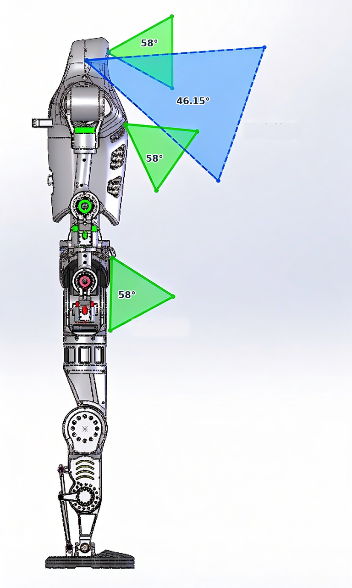
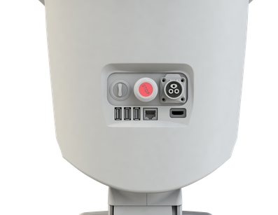

# 部件与接口

本页介绍 W1 的感知配置和软件接口。

## 感知部件

环境与工件感知配置包括激光雷达、ToF 相机和 3D 线扫相机。

| 部件        | 参考数量 | 型号与性能     |
| ----------- | -------- | -------------- |
| 激光雷达    | 1 台     | MID360         |
| ToF 相机    | 3 台     | Realsense 435i |
| 3D 线扫相机 | 1 台     |                |

不能由传感器类别推导 USB、以太网等物理接口、供电参数或可用 SDK；数量与型号需按实际交付配置确认。其能力背景见[能力与应用](./capabilities.md)。

## 背部接口示意图

| 参数名   | 数量 | 备注   |
| -------- | ---- | ------ |
| HDMI     | 1个  | —      |     |
| USB      | 3个  | 3.0    |
| 千兆网口 | 1个  | RJ45   |
| 充电接口 | 1个  | 5A Max |
| 急停按钮 | 1个  |        |
| 电源开关 | 1个  |        |

## 软件接口

以下软件接口适用于文档所述 `speed_W1_v1.2` 配置。软件端点不能代替实物端口编号或接线图。

| 用途           | 已有入口                            | 接入条件与详细说明                                                                                                   |
| -------------- | ----------------------------------- | -------------------------------------------------------------------------------------------------------------------- |
| 关节反馈       | `/joint_states`                     | 按关节名称读取；消息字段与订阅示例见 [ROS 2 示例](../sdk/ros2-example.md#状态话题)                                   |
| IMU 与硬件状态 | `/imu/data`、动态关节状态和诊断话题 | 由相应真机 broadcaster 或监控节点提供；默认仿真不提供硬件 IMU 数据，见 [ROS 2 示例](../sdk/ros2-example.md#状态话题) |
| 双臂示教       | `/arm_move`                         | 默认提供示教接口；消息格式和服务可用范围见 [W1 ROS 2 接口示例](../sdk/ros2-example.md#单臂与双臂示教)                |
| 整机与双臂控制 | PVT 和分组关节命令                  | 26 轴顺序、单位与数组长度见 [W1 整机控制接口](../api/w1-control.md)                                                  |

已有软件接入路径见 [W1 ROS 2 示例](../sdk/ros2-example.md)；正式硬件连接步骤待资料齐备后补充。
