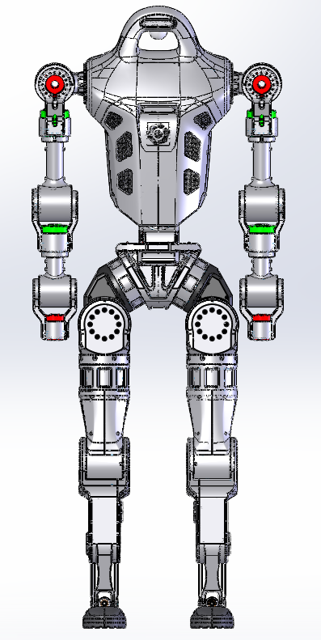

# 型号与规格

本页列出 W1 的部分主要参数。

## 型号识别

| 标识           | 已有信息                           |
| -------------- | ---------------------------------- |
| 产品名称       | Weldroid-W1   |
| 实物识别       | 见封面图       |
| ROS 2 配置标识 | 本手册接口文档使用 `speed_W1_v1.2` |

软件模型的配置与查询方式见 [W1 整机控制接口](../api/w1-control.md)。

## 本体参考参数

机械结构示意图

| 参数       | 参考值         | 单位 | 条件与说明                                       |
| ---------- | -------------- | ---- | ------------------------------------------------ |
| 机器人形态 | 全尺寸双足人形 | —    | 面向船舶等复杂焊接工位                           |
| 身高       | 约 1.7         | m    | |
| 全身自由度 | 28             | 个   | 见机械图     |
| 单臂负载   | 10             | kg   |  |
| 整机负载   | 30             | kg   | |

## 指标与条件

| 类别           | 实测数据                                               |
| -------------- | ---------------------------------------------------------------- |
最大行走速度       | 1.5M/秒                      |
最大越障高度       | 25CM                      |
电池规格       | 48V 20AH                      |
| 续航时间     | 持续行走4小时                          |
| 充电时间     | 充电1.5小时 |

## 28 个受控轴

| 资料范围                       | 数值                          | 对开发者的含义                                                |
| ------------------------------ | ----------------------------- | ------------------------------------------------------------- |
`speed_W1_v1.2` ROS 2 控制配置 | 28 个受控轴；腿腰 14、双臂 14 | 当前接口的命令顺序与数组长度依据此配置，全身 PVT 数据为 84 项 |

程序接入应核对运行中的 `robot_model`、`joints` 参数及已安装配置；28 轴完整顺序与 PVT 格式见 [W1 整机控制接口](../api/w1-control.md)。

## 场景
船舶场景、作业姿态与感知能力见[能力与应用](./capabilities.md)；部件位置与物理连接资料的缺项见[部件与接口](./interfaces.md)。
